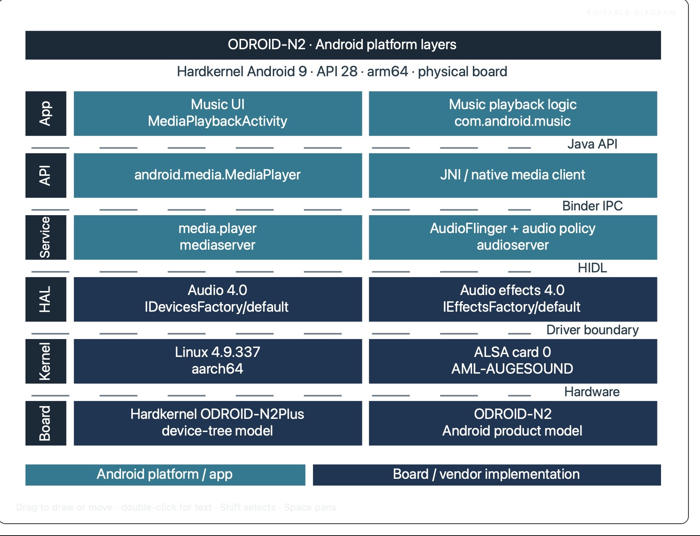
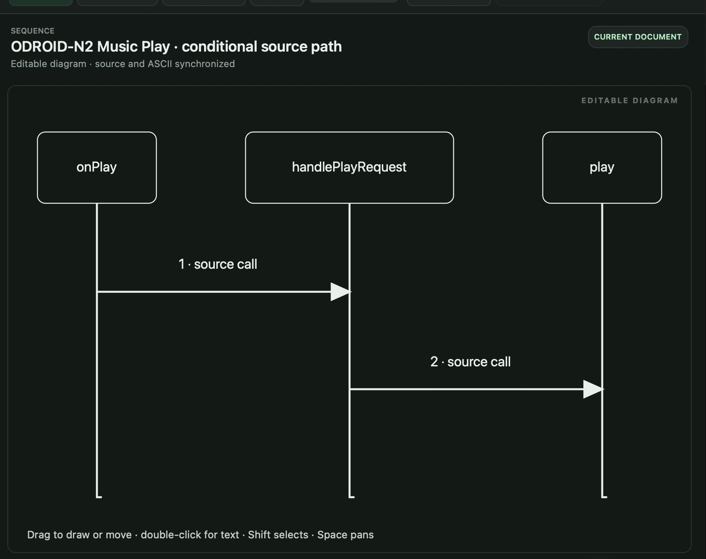

# Studio Draw

Draw architecture, sequence, flow and use-case diagrams on your Mac. Start with a built-in example, describe a diagram in chat, or use a screenshot to guide its layout and colors. Save an editable drawing or export a styled HTML page you can share.

**Studio Draw 0.15.1** · Apple Silicon · macOS 14 or later

[Download Studio Draw 0.15.1](https://github.com/abhinema/Studio-Draw/releases/download/v0.15.1/Studio-Draw-0.15.1-arm64.dmg) · [Install on your Mac](#install-on-your-mac) · [Try a diagram](#try-a-diagram) · [Use your own screenshot](#use-your-own-screenshot)

## Install on your Mac

1. Open [Releases](https://github.com/abhinema/Studio-Draw/releases) and select **Studio Draw 0.15.1**.
2. Under **Assets**, download **Studio-Draw-0.15.1-arm64.dmg**.
3. Open the disk image, drag **Studio Draw** to **Applications**, then open it from Applications.

**Signing status.** This build uses a local signing identity. Apple notarization is pending for public distribution, so macOS may block the first launch on another Mac.

## Work in a project

Choose **File → New Project…** to organize diagrams into System Architecture, Software Architecture (HLD), Features and Use Cases. Select a folder in the sidebar to see its files. Select a drawing to open it in the same window.

Use **Diagram theme…** to apply Colorful, Neon or Carbon Blueprint. Save the drawing to keep its colors. To open an earlier version by default, select it in version history, choose **Make default**, and save.

In the assistant, type a prompt or use **Dictate** and review the transcript before sending. Inspect the proposed diagram, choose **Build**, and then **Apply diagram** when the preview is ready. To keep the prompt with your project notes, open **Timeline → Request sent → Copy request prompt**.

## Sample HTML exports

**[ODROID-N2 Media Playback — complete project example](examples/ODROID-N2-Media-Playback.html)** brings together the board hardware, software architecture, playback sequences, and Play/Pause use cases in one offline HTML file. Open any diagram by selecting its title. Android 12 source examples and emulator observations are labeled separately from the Android 9 board.

Download any example using **Download raw file** on its GitHub file page, then open the saved HTML in a browser. Each file contains the diagram and its interactive viewer and works offline.

| Diagram | What it shows | HTML export |
| --- | --- | --- |
| Layered architecture | Android 9 platform layers and their interface boundaries on ODROID-N2. | [View file](examples/ODROID-N2-Platform-Layers.html) |
| Sequence diagram | Two conditional source calls from onPlay to play in the Music app. | [View file](examples/ODROID-N2-Music-Play.html) |
| Flowchart | Pause decisions when the controller is unavailable or the player is already paused. Android 12 source reference. | [View file](examples/Pause-Flow.html) |
| Use-case diagram | One occupant and two playback goals. Android 12 source reference. | [View file](examples/Play-and-Pause-Use-Cases.html) |

## Version archive

In **Releases**, choose the tag for the version you want. Each release includes an Apple Silicon DMG and its SHA-256 checksum. The public installers were repackaged on 12 November 2026. If you already have the same version, eject its old disk image and download the new DMG and matching checksum. Open the new image to read its release notes; drag the app to Applications to replace your installed copy.

| Version | Packaged | Change |
| --- | --- | --- |
| [0.15.1](https://github.com/abhinema/Studio-Draw/releases/tag/v0.15.1) | 12 Nov 2026 | Reusable diagram palettes |
| [0.15.0](https://github.com/abhinema/Studio-Draw/releases/tag/v0.15.0) | 12 Nov 2026 | Open a Music Play sequence and inspect its source references |
| [0.14.4](https://github.com/abhinema/Studio-Draw/releases/tag/v0.14.4) | 10 Nov 2026 | Keep both plans when recovering a version |
| [0.14.3](https://github.com/abhinema/Studio-Draw/releases/tag/v0.14.3) | 10 Nov 2026 | Preserve plans, shared labels and voice drafts |
| [0.14.2](https://github.com/abhinema/Studio-Draw/releases/tag/v0.14.2) | 10 Nov 2026 | Keep work when project switching is interrupted |
| [0.14.1](https://github.com/abhinema/Studio-Draw/releases/tag/v0.14.1) | 10 Nov 2026 | Protect drafts when switching diagrams |
| [0.14.0](https://github.com/abhinema/Studio-Draw/releases/tag/v0.14.0) | 10 Nov 2026 | Project folders |
| [0.13.0](https://github.com/abhinema/Studio-Draw/releases/tag/v0.13.0) | 09 Nov 2026 | Editable sequence diagrams with saved source references |

## Try a diagram

1. Choose **File → New from Example → AOSP — platform architecture**. This example works offline. Click **Fit** to see the whole stack.
2. Choose **Diagram theme… → Carbon Blueprint**. Use **File → Save As…** to keep your own editable copy.
3. Choose **Export → HTML — styled diagram** and click **Export…**. Open the saved HTML in a browser to see what a reader will receive.

Choose a layered architecture to show where components belong. Choose a sequence to show who calls whom, a flowchart to show a decision, or a use-case diagram to show what the user wants to achieve.

The ODROID-N2 Music Play example shows two conditional calls found in the Android Music source. The arrows describe a possible call path.

## Use your own screenshot

In **Settings → Assistant**, choose your provider and model. For an image attachment, use an image-capable Ollama or Ollama Cloud model and save the settings. Attach a PNG or JPEG with the paperclip, then describe the subject and which parts of the image to reuse.

> Create a photo-library diagram with three layers named Gallery UI, Image Index and Local Storage. Use the screenshot’s teal and navy colors and dashed layer boundaries. Keep the labels about the photo library.

Inspect the preview, choose **Build**, then **Apply diagram**. To reuse the resulting colors in another drawing, choose **Diagram theme… → Save palette from drawing…**. To recreate the pictured block diagram itself, configure **Settings → Assistant → Visual reviewer**, then choose **Recreate from snapshot…** in a blank drawing.
